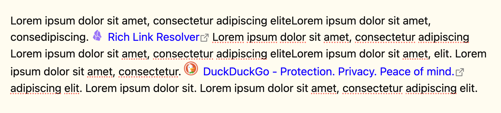

<h1>Rich Link Resolver</h1>

<h3>Paste a URL. Get a clean link with the page title and favicon.</h3>

  Rich Link Resolver turns bare URLs in your Obsidian notes into readable links, 
  or full preview cards, without leaving the editor.

  <a href="#features">Features</a> &nbsp;·&nbsp;
  <a href="#install">Install</a> &nbsp;·&nbsp;
  <a href="#settings">Settings</a> &nbsp;·&nbsp;
  <a href="#privacy">Privacy</a> &nbsp;·&nbsp;
  <a href="#support">Support</a>

 

Pasted URLs become a favicon and a title, right inside the paragraph.

 

## How it works

|  1. Paste  |  2. Resolve  |  3. Keep writing  |
| :---: | :---: | :---: |
| Paste a URL anywhere in your note. | A short `Loading URL...` placeholder appears while the page is fetched. | It is replaced by the page title and favicon, as a normal markdown link. |

 

## Features

| | |
| :---: | :---: |
| **Paste and done** A single pasted URL is resolved automatically. You can also resolve the selected URL, or the one under your cursor, from the command palette or the context menu. | **Preview cards** Prefer something bigger? Render a card with the title, description, favicon and domain. Cards are used when the URL sits on its own line, so they never break a sentence. |
| **Make it fit your theme** Put the favicon before or after the title, turn it off, or tune its size, spacing and vertical offset. Changes also apply to the links you already have. | **Ignore list** Skip automatic conversion for domains (subdomains included) and for exact URLs. Pasted URLs and `*.example.com` work as rules. |
| **Safe by default** Your note is left alone when a link would not belong there: inside code, link text, `[[wikilinks]]`, frontmatter, or when you paste over selected text to wrap it in a link. | **Never gets stuck** If a site is slow, unreachable or answers with an error, you get a link with the domain name after 10 seconds instead of a stuck placeholder. |

 

## Install

Open **Settings → Community plugins → Browse**, search for **Rich Link Resolver**,
then install and enable it. Or [open it on the Obsidian site](https://obsidian.md/plugins?id=rich-link-resolver).

Prefer a manual install? Download `main.js`, `manifest.json` and `styles.css` from the
[latest release](https://github.com/almeidazs/rich-link-obsidian/releases/latest)
into `<your vault>/.obsidian/plugins/rich-link-resolver/`.

Works on desktop and mobile, Obsidian 1.5.1 or newer.

 

## Settings

| Setting | What it does |
| :---: | :---: |
| **Icon position** | Favicon before or after the title |
| **Render links as cards** | Insert preview cards instead of favicon + title links |
| **Show favicon** | Turn the icon off for plain title links |
| **Favicon size** | 8 to 48 px |
| **Favicon spacing** | Extra space between the icon and the title |
| **Favicon vertical offset** | Nudge the icon up or down to line it up with your theme's text |
| **Ignored domains** | One per line, subdomains included |
| **Ignored URLs** | One exact `http` or `https` URL per line |

 

## Privacy

The plugin only contacts the URL you paste, from your own device, to read its title,
description and icon. There is no account, no analytics and no server of ours in between.
When a site has no usable icon, the link points to Google's favicon service instead.

 

## Support

Found a bug or have an idea? [Open an issue](https://github.com/almeidazs/rich-link-obsidian/issues).
If the plugin saves you time, a ⭐ on the repo helps others find it.

 

Released under the [Apache License 2.0](LICENSE) · Made by [@eualmeidazs](https://x.com/eualmeidazs)

